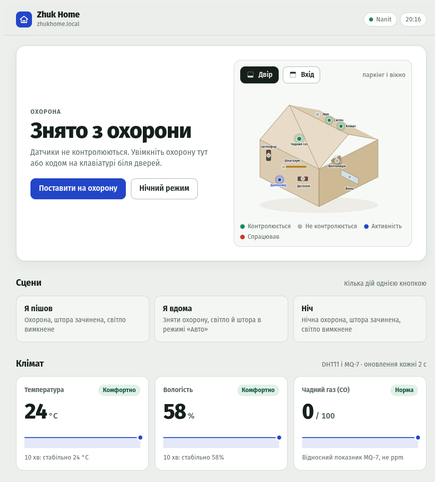
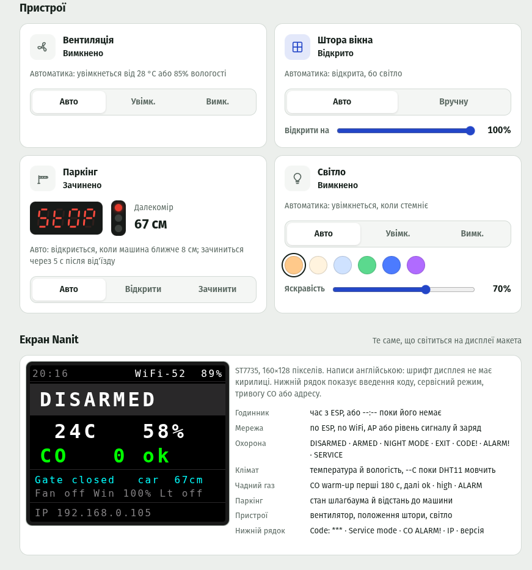

# Zhuk Home

Власна прошивка й вебінтерфейс для навчального макета розумного будинку [Nanit](https://github.com/NanitRobot).
Фанерний будиночок із дванадцятьма портами перетворюється на систему, яка сама стежить за
домом, пам'ятає свій стан і відкривається з телефона.

## На чому побудовано

За основу взято навчальні проєкти NanitRobot:

- [ud_v3.1](https://github.com/NanitRobot/ud_v3.1) — схема макета й логіка розумного будинку;
- [Nanit_WIFI_interface](https://github.com/NanitRobot/Nanit_WIFI_interface) — оригінальна
  прошивка й сторінка для ESP8266 Witty Cloud;
- [NanitLib](https://github.com/NanitRobot/NanitLib) — бібліотека плати.

Схему збирання взято звідти без змін, жодного дроту не перепаяно. Код написано заново — від
протоколу обміну до власних драйверів дисплея, клавіатури й DHT11.

## Що потрібно

| Що | Вимога |
| --- | --- |
| Макет | [NanitRobot/ud_v3.1](https://github.com/NanitRobot/ud_v3.1), зібраний за штатною схемою |
| Контролер | Nanit на ATmega2560 (плата 3.1 або давніша) |
| Вебмодуль | ESP8266 Witty Cloud у порту 11 |
| Бібліотеки | Nanit: `NanitLib` із залежностями й `Servo`; ESP: `WebSockets` — решта драйверів свої |

Що стоїть на портах:

| Порт | Модулі |
| --- | --- |
| 1 | сервопривід штори, двигун вентилятора |
| 2 | кроковий двигун шлагбаума |
| 3 | світлофор паркінгу |
| 4 | RGB-світло |
| 5 | датчик руху, датчик звуку, зумер, датчик вікна |
| 6 | DHT11, MQ-7, датчик освітленості |
| 7 і 10 | клавіатура 4×4 |
| 9 | далекомір HC-SR04, дисплей TM1637 |
| 11 | ESP8266 Witty Cloud |

## Швидкий старт

1. **Залийте прошивку Nanit** — Arduino IDE або `sh nanit/flash.sh`.
   → [Збірка й заливка](docs/getting-started.md)
2. **Перевірте залізо** — `sh nanit/hw_test/run.sh` перевірить усі модулі й скаже, що живе.
   → [Перевірки](docs/testing.md)
3. **Підженіть під свій макет** — кути штори, нуль шлагбаума, потенціометри датчиків.
   → [Калібрування](docs/calibration.md)
4. **Залийте прошивку ESP і підключіть до Wi-Fi** — модуль підніме власну точку доступу
   `ZhukHome-XXXX`, де й спитає мережу. → [Модуль ESP8266](docs/esp-module.md)

Далі — [як цим користуватись](docs/usage.md).

## Документація

| Файл | Про що |
| --- | --- |
| [getting-started.md](docs/getting-started.md) | зібрати, залити, перший запуск обох прошивок |
| [usage.md](docs/usage.md) | як користуватись: охорона, сцени, пристрої, екран макета |
| [calibration.md](docs/calibration.md) | підігнати під своє залізо: кути, нуль стріли, потенціометри |
| [esp-module.md](docs/esp-module.md) | мережа, час, журнал подій, оновлення прошивки, сторінка |
| [testing.md](docs/testing.md) | перевірки: монітор порту, автопрогін на макеті, тести на комп'ютері |
| [architecture.md](docs/architecture.md) | як усе влаштовано й де що лежить у репозиторії |
| [protocol.md](docs/protocol.md) | протокол обміну Nanit ↔ ESP: кадри по UART |
| [api.md](docs/api.md) | що ESP віддає в мережу: HTTP на `:80` і WebSocket на `:81` |
| [CHANGELOG.md](CHANGELOG.md) | версії обох прошивок |

## Від демонстрації до будинку

Макет Nanit збирається за вечір. Десяток модулів, клавіатура на дверях, шлагбаум у дворі,
шторка на вікні — і демонстраційний скетч, який показує, що все це справді працює:
серво крутиться, дисплей світиться, датчик реагує.

А потім настає момент, коли хочеться, щоб воно не показувало, а **працювало**. Щоб будинок
сам зачиняв штору на ніч, вмикав вентиляцію, коли душно, відчиняв шлагбаум машині, що під'їхала,
і зчиняв тривогу, якщо хтось відчинив вікно, поки нікого немає.

Між цими двома станами лежить несподівано багато роботи — і майже вся вона не про код, а про
залізо. З'ясувалося, наприклад, що вентилятор своїми завадами глушить власний канал керування:
поки він крутиться, команда «вимкнути» фізично не доходить. Що мікрофон чує плескіт лише в
одному випадку з двадцяти — його імпульси коротші, ніж прохід головного циклу. Що шлагбаум
після вимкнення живлення вважає підняту стрілу опущеною й довертає її ще на 90°.

Ця прошивка — відповідь на такі знахідки. Майже кожна константа в ній має поряд коментар:
що було до неї, чому попереднє значення не працювало й що саме зміряли на макеті.

## Що вміє будинок

- **Охорона** з трьох датчиків — рух, звук, вікно. Затримка на вихід, затримка на вхід,
  сирена, код на клавіатурі біля дверей. Стан переживає вимкнення живлення: якщо будинок
  стояв під охороною, він і підніметься під охороною.
- **Нічний режим** — рух у домі ігнорується, а вікно й звук — ні.
- **Клімат** — температура й вологість із DHT11, провітрювання за порогами з гістерезисом.
- **Тривога через чадний газ** — жовтий рівень, червоний рівень, автоматичне провітрювання,
  відчинена штора й сирена, яку можна заглушити, не скасовуючи саму тривогу.
- **Штора** — за освітленістю або вручну. Жест рукою біля вікна перемикає її й переводить у
  ручний режим. Захист від защемлення не дає зачинити штору на перешкоду навіть під охороною.
- **Паркінг** — шлагбаум піднімається перед машиною, що під'їхала, і опускається, коли вона від'їхала.
  Світлофор і дисплей із відстанню працюють паркувальним асистентом.
- **Світло** — RGB за рухом у темряві, з вибором кольору та яскравості; під час тривоги
  блимає червоним.
- **Сцени** — «Я пішов», «Я вдома», «Ніч»: кілька дій однією кнопкою.
- **Журнал подій** із часом і причиною: не просто «вентилятор увімкнено», а «увімкнено — CO».
- **Вебінтерфейс** у прошивці ESP8266: працює без інтернету, оновлюється миттєво, показує
  навіть те, що світиться на екрані самого макета.

Будинок **не залежить від Wi-Fi**: уся автоматика живе на контролері Nanit. ESP8266 лише
показує стан і передає команди. Вимкніть його — і зникнуть рівно три речі: вебінтерфейс,
годинник і журнал подій.

## Як це виглядає

Головна сторінка: стан охорони з планом будинку, сцени й клімат. Усе, що на ній видно,
приходить кадрами від Nanit — сторінка нічого не вигадує сама.

Нижче — пристрої з режимами й дзеркало екрана макета: те саме, що світиться на дисплеї
будиночка, разом із розшифровкою кожного рядка.

## Подивитись, не збираючи макет

Прототип інтерфейсу з імітованим будинком: датчики, події й рухи механізмів придумує сама
сторінка.

**https://zhekazh.github.io/zhuk-home-nanit/web/prototype.html**

Поруч — [ізометрична схема макета](https://zhekazh.github.io/zhuk-home-nanit/web/plan.html),
з якої взято будиночок у прототипі.

Обидві сторінки самодостатні, тож їх так само можна відкрити просто з диска: без сервера,
без Wi-Fi і без самого макета.

## Ліцензія

Код і документація цього проєкту — [MIT](LICENSE).

Макет, схема збирання й бібліотека `NanitLib` належать [NanitRobot](https://github.com/NanitRobot):
ця прошивка написана заново й лише працює з їхнім залізом. Базові проєкти
[ud_v3.1](https://github.com/NanitRobot/ud_v3.1) і
[Nanit_WIFI_interface](https://github.com/NanitRobot/Nanit_WIFI_interface) сюди **не входять**
і не перевикладаються: власної ліцензії вони не мають, тож усі права на них лишаються за
авторами. Щоб зібрати прошивку Nanit, `NanitLib` треба встановити окремо — як і будь-яку
іншу бібліотеку Arduino.
